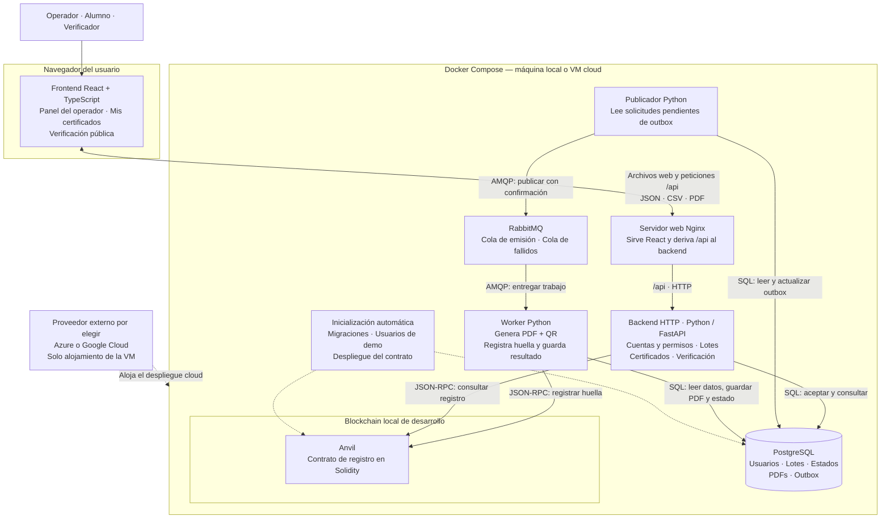

# Arquitectura con frontend y backend separados

Propuesta actualizada el 09/11/2026 por preferencia del equipo: frontend React separado y backend Python/FastAPI. El sistema sigue siendo una PoC con un único despliegue Compose; separar frontend y backend no exige convertir los módulos del backend en microservicios.

## Vista de componentes y despliegue

Las flechas indican quién solicita una operación o entrega un trabajo; las respuestas se omiten salvo en la comunicación del navegador. Las líneas punteadas representan inicialización y alojamiento. React se ejecuta en el navegador; dentro de Compose queda el servidor que entrega sus archivos. El comando `docker compose up` construirá esos archivos y arrancará los servicios e inicialización. En local no se necesita proveedor cloud.

## Módulos del frontend

| Módulo | Responsabilidad | Comunicación |
| --- | --- | --- |
| Sesión y navegación | Acceso y navegación según el rol | API de cuentas/sesión |
| Panel del operador | Cargar curso/fecha/CSV, ver errores de validación y avance del lote | API de lotes; consulta periódica del avance |
| Mis certificados | Listar certificados del alumno y descargar sus PDFs | API de certificados |
| Verificación pública | Consultar QR/identificador y subir PDF para comprobar integridad | API de verificación, sin cuenta |

El frontend contiene presentación y estado de pantalla. El backend vuelve a validar entradas y permisos; ocultar un botón en React no concede ni revoca permisos. React no accede directamente a PostgreSQL, RabbitMQ o Anvil, y el usuario no necesita MetaMask ni una billetera.

## Módulos del backend

| Módulo lógico | Responsabilidad | Dependencias |
| --- | --- | --- |
| Cuentas y acceso | Identidad de operador/alumno, sesión y permisos | PostgreSQL |
| Lotes de emisión | Validar CSV completo, identificar alumnos, detectar duplicados y aceptar el lote | PostgreSQL y outbox |
| Certificados | Consultar resultados y autorizar listado/descarga por alumno | PostgreSQL |
| Verificación | Calcular huella del PDF y consultar el registro; devolver datos públicos permitidos | PostgreSQL para metadatos, Anvil para comprobar el registro |
| Emisión | Preparar el archivo PDF/QR, asegurar idempotencia y registrar su huella | PostgreSQL, generador PDF y adaptador blockchain |

Son módulos de una base de código Python. La API HTTP usa cuentas, lotes, certificados y verificación; el worker ejecuta emisión. El publicador de outbox es otro proceso Python de esa misma base. PostgreSQL es compartido por estos procesos: no hay una base por módulo ni llamadas HTTP internas entre todos ellos. FastAPI permite organizar rutas por módulos mediante [APIRouter](https://fastapi.tiangolo.com/tutorial/bigger-applications/).

## Recorridos principales

**Emitir:** React envía CSV y datos del curso → API valida y persiste lote/solicitudes/outbox en una transacción → publicador envía mensajes a RabbitMQ → worker genera y conserva cada PDF con QR → registra su huella en el contrato de Anvil → actualiza el estado → React consulta el avance.

El publicador de outbox evita depender de que PostgreSQL y RabbitMQ estén disponibles a la vez al aceptar el lote: conserva la intención de publicación. Si el broker confirma y el publicador cae antes de guardar la confirmación, puede haber una reentrega; la emisión debe ser idempotente.

**Obtener certificado:** alumno inicia sesión → React consulta sus certificados → API aplica permisos y entrega el PDF ya generado. No se regenera el documento en cada descarga porque su huella debe mantenerse.

**Verificar:** el QR abre una ruta pública de React y esta consulta la API. Si se sube el PDF, la API calcula su huella y comprueba el registro en Anvil. La respuesta distingue coincidencia, documento no registrado, alteración e indisponibilidad. Escanear el QR por sí solo permite consultar los datos, no probar que el PDF que contiene ese QR esté intacto.

## Frontera frontend/backend y construcción

Propuesta de herramientas: React + TypeScript + Vite para el frontend; FastAPI/Python para el backend. Vite genera archivos desplegables mediante su [proceso de construcción](https://vite.dev/guide/build.html). Se construyen dentro de una imagen Docker y se sirven con Nginx; no hace falta instalar Node en la máquina del evaluador ni ejecutar un servidor Node en producción.

Nginx entrega los archivos de React y reenvía `/api` a FastAPI usando su [módulo de proxy HTTP](https://nginx.org/en/docs/http/ngx_http_proxy_module.html). Se usa una URL de entrada para ambos: la separación de proyectos, responsabilidades e imágenes se conserva y se evita depender de dos dominios. Configurar el fallback de rutas de React sin capturar `/api`; las respuestas y errores de API siguen siendo del backend.

En desarrollo puede usarse el servidor de Vite con un proxy hacia la API. Esa comodidad no reemplaza la composición reproducible de entrega. La configuración de HTTPS cloud dependerá de la VM y el nombre público disponibles; la URL del QR debe fijarse antes de generar los certificados de la demo.

## Proveedores externos

| Dependencia | ¿Se necesita? | Alcance |
| --- | --- | --- |
| Hosting cloud | Sí, para el entregable desplegado | Una VM de Azure o Google Cloud, por confirmar elegibilidad/créditos; aloja el Compose completo |
| Proveedor de autenticación | No para el alcance base | Cuentas de demo y autenticación gestionadas por el backend |
| Proveedor blockchain/RPC público | No | Anvil corre dentro de Compose; no hay red pública, gas real ni servicio RPC contratado |
| Base de datos o broker administrados | No | PostgreSQL y RabbitMQ se ejecutan como contenedores propios |
| Almacenamiento de PDFs externo | No | PDFs conservados en PostgreSQL para esta escala |
| Email | No | Los alumnos acceden a sus PDFs desde el portal |

La descarga inicial de paquetes e imágenes necesita internet, pero esos registros no forman parte del recorrido de negocio una vez construido el sistema. La blockchain sigue siendo controlada por el equipo: esta arquitectura no demuestra descentralización ni ofrece un certificado oficial por sí misma.

Ver [arquitectura detallada](architecture.md) para consistencia, persistencia e inicialización, y [mapa de decisiones](decision-map.md) para las dependencias abiertas de hosting y disponibilidad del equipo.
