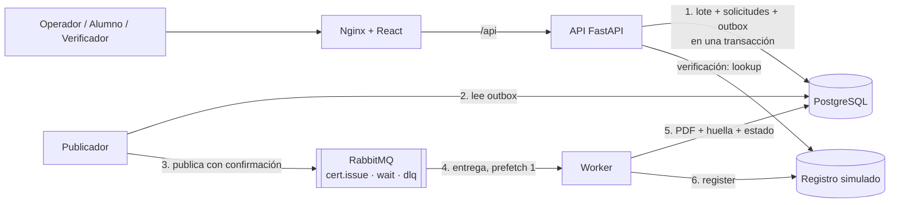

<!--
NOTA PARA EL EQUIPO (no se renderiza; borrar antes de entregar)
- Borrador iniciado el 14/11/2026 (frente D). Límite: 5 páginas de cuerpo (secciones 1 a 5),
  sin contar portada, índice ni anexos. El cuerpo apunta a unas 2300 palabras + 1 diagrama.
- REGISTRO SIMULADO confirmado: C entregó SimulatedRegistry; blockchain no integra la entrega.
- Todo lo marcado ⟨PENDIENTE⟩ se completa SOLO con resultados de evidence/. No inventar números.
- Falta del grupo: nombre del grupo, integrantes, horas-persona por frente (§5.3).
- Si el frontend React no llega, corregir §3 ("Un frontend React se sirve detrás de Nginx").
- LARGO (medido el 16/11, A4, márgenes 2 cm, 11 pt): el cuerpo ocupa 5 páginas JUSTAS (~3 líneas
  libres). Todo agregado obliga a recortar otra cosa. Al exportar el PDF final, revisar que el diagrama
  mermaid renderizado no empuje el texto a una sexta página.
-->

# Emisión y verificación de certificados académicos con procesamiento asincrónico confiable

**White paper — Trabajo Práctico Integrador Final, Ingeniería de Software II, 2.º cuatrimestre 2026**

Grupo: ⟨completar⟩ · Integrantes: ⟨completar⟩ · Fecha de entrega: 19/11/2026

Eje técnico elegido: **RabbitMQ** (sistemas distribuidos, colas de mensajes).

---

## Índice

1. Problema, actores y alcance
2. Alternativas y decisión técnica
3. Arquitectura y recorrido
4. Investigación aplicada: entrega confiable con RabbitMQ
5. Resultados, limitaciones y recursos

Anexos: A. Ejecución y datos de prueba · B. Escenarios y evidencia · C. Referencias

---

## 1. Problema, actores y alcance

### 1.1 Problema de negocio

Los certificados académicos en papel o en PDF simple no tienen una forma práctica de comprobar su origen. Esto facilita la falsificación y obliga a que cada verificación pase por la institución emisora: un empleador o una universidad que recibe un certificado escribe a la secretaría y espera una respuesta manual, que puede demorar semanas. Para la institución, cada consulta y cada duplicado solicitado es trabajo administrativo repetido.

El producto propuesto permite a una institución **emitir certificados de finalización de cursos por lote** y a cualquier tercero **verificar al instante** que un documento coincide con el registrado por el emisor, sin intervención manual. El modelo de negocio es B2B, orientado a universidades, institutos de capacitación y empresas.

### 1.2 Actores

- **Operador institucional:** persona autorizada por la institución; carga un lote (curso, fecha y CSV con los alumnos aprobados) y sigue su avance.
- **Alumno:** ingresa a «Mis certificados» y descarga sus PDFs.
- **Verificador:** sin cuenta; escanea el QR del certificado o sube el PDF para comprobarlo.

### 1.3 Por qué es un problema complejo

Emitir un certificado no es una sola escritura: requiere generar un PDF con QR, calcular su huella criptográfica (SHA-256), registrarla y guardar el resultado. Para un lote de decenas o cientos de alumnos, hacerlo dentro de una petición HTTP implica esperas largas y, sobre todo, **un problema de consistencia ante fallas**: si el proceso se interrumpe a mitad del lote, ¿qué certificados se emitieron? ¿Reintentar duplica los ya emitidos? El requisito de negocio es explícito: **el lote debe terminar pese a interrupciones, sin perder ni duplicar certificados**, y el operador debe poder identificar qué falló y por qué.

### 1.4 Alcance de la prueba de concepto

La PoC implementa el recorrido completo con datos sintéticos: una institución, un operador y 25 alumnos precargados. Incluye carga y validación del CSV (se rechaza completo si hay errores), procesamiento asincrónico de un trabajo por certificado, reintentos acotados, cola de fallidos, portal del alumno y verificación pública. La huella de cada certificado se guarda en un **registro simulado**: una tabla de solo inserción detrás de una interfaz reemplazable (ver §2.3).

Quedan fuera: múltiples instituciones, aplicación móvil y billetera, revocación, alta disponibilidad y métricas comerciales con usuarios reales.

---

## 2. Alternativas y decisión técnica

### 2.1 Necesidades que guían la decisión

| Necesidad de negocio | Atributo de calidad | Requisito técnico |
| --- | --- | --- |
| El operador no espera a que se emita todo el lote | Desempeño percibido | Aceptar el lote y procesarlo en segundo plano |
| Un lote interrumpido termina sin rehacerse | Confiabilidad, tolerancia a fallas | Trabajos persistentes que sobreviven caídas |
| Nunca dos certificados para el mismo alumno, curso y fecha | Integridad | Procesamiento idempotente ante reentregas |
| Un error en un alumno no frena al resto | Disponibilidad parcial | Aislamiento por trabajo, reintentos y cola de fallidos |
| Diagnosticar qué pasó con cada certificado | Observabilidad | Estado persistido, intentos y un identificador de correlación |

### 2.2 Comparativa

| Alternativa | A favor | En contra para este caso |
| --- | --- | --- |
| **HTTP síncrono, sin cola** | Menos componentes; suficiente para emitir uno por vez | El operador espera todo el lote; una caída a mitad deja el lote en estado incierto y la recuperación hay que construirla a mano |
| **Tabla de trabajos en PostgreSQL** (sondeo con `SKIP LOCKED`) | Sin servicio extra; transaccional con los datos | Reintentos con espera, cola de fallidos y entrega a consumidores hay que programarlos; mezcla el almacenamiento con la distribución de trabajo. A esta escala sería viable |
| **RabbitMQ** | Cola de trabajos con ACK por mensaje, reentrega automática, colas con TTL y *dead-letter exchanges* nativos | Un servicio más que operar; entrega «al menos una vez», lo que exige consumidores idempotentes |
| **Kafka** | Log de eventos retenido, múltiples consumidores, relectura histórica, alto volumen | Su modelo es un log particionado con *offsets*, no confirmación por mensaje: los reintentos con espera y la cola de fallidos se construyen con tópicos adicionales. Agrega decisiones de particionado que este flujo no necesita |
| **Prefect / Airflow** | Orquestación de flujos con estados, reintentos y visualización | Orientados a pipelines y tareas programadas; resolverían la orquestación pero no la distribución confiable de trabajos independientes |

**Decisión: RabbitMQ.** El flujo es una **cola de comandos independientes** (emitir el certificado X), no un stream de eventos que varios sistemas deban releer. RabbitMQ resuelve de forma nativa lo que este caso necesita: confirmación por mensaje, reentrega ante caídas, reintento diferido y aislamiento de fallidos. Kafka sería preferible si el centro del producto fuera la auditoría o el reprocesamiento de eventos históricos, o si muchos sistemas consumieran las emisiones. La tabla de trabajos en PostgreSQL es una alternativa honesta a esta escala; la descartamos porque obliga a reimplementar reintentos y aislamiento de fallidos, que el broker ya ofrece y son el objeto de estudio.

### 2.3 Registro de huellas

La visión del producto contempla registrar las huellas en una blockchain para que un tercero no dependa de la base de datos de la institución. Para la PoC, el registro es **simulado**: una tabla `registry` de solo inserción en PostgreSQL, accesible únicamente a través de la interfaz `register(cert_id, hash)` / `lookup(cert_id)`. Esto permite demostrar la verificación (original, alterado, inexistente, servicio no disponible) y la idempotencia del registro. Reemplazarlo por un contrato inteligente no cambia la API ni el frontend. **No se presenta como blockchain**: la confianza sigue depositada en quien administra la base.

---

## 3. Arquitectura y recorrido

La solución es un **monolito modular** en Python con tres procesos separados que comparten código y base de datos: API HTTP (FastAPI), publicador y worker. Un frontend React se sirve detrás de Nginx. Todo se levanta con `docker compose up`, en local y en una VM en la nube.

**Recorrido de un lote:**

1. El operador sube curso, fecha y CSV. La API valida **todo el archivo** (emails sin cuenta, repetidos, certificados ya existentes) y, si hay errores, lo rechaza indicando las filas a corregir.
2. Si es válido, guarda en **una sola transacción** el lote, una solicitud `PENDING` por alumno y una fila de *outbox* por solicitud. Responde de inmediato con el identificador del lote.
3. El **publicador** lee el outbox y publica cada mensaje en RabbitMQ. Recién cuando el broker confirma la recepción marca la fila como publicada.
4. El **worker** recibe un mensaje (solo identificadores: `request_id`, `correlation_id`), lee los datos desde PostgreSQL, genera el PDF con QR **una sola vez**, calcula su SHA-256, lo registra, marca la solicitud `ISSUED` y recién entonces confirma (ACK) el mensaje.
5. El operador ve el avance por alumno; el alumno descarga su PDF; el verificador consulta el QR o sube el PDF, y la API compara su huella con el registro.

**Topología de RabbitMQ:** el exchange `certs` enruta a la cola de trabajo `cert.issue`. Si el worker rechaza un mensaje por una falla transitoria, el *dead-letter exchange* lo envía a `cert.issue.wait`, cuyo TTL lo devuelve a la cola de trabajo pasados unos segundos (reintento diferido, sin bucles inmediatos). Las fallas permanentes se publican en `cert.issue.dlq` para inspección.

---

## 4. Investigación aplicada: entrega confiable con RabbitMQ

### 4.1 Conceptos

- **Durabilidad y persistencia.** Las colas se declaran durables y los mensajes como persistentes (`delivery_mode=2`), de modo que sobreviven a un reinicio del broker. Son dos condiciones distintas: una cola durable con mensajes no persistentes pierde su contenido.
- **Confirmaciones del publicador (*publisher confirms*).** Con el canal en modo confirmación, el broker responde `ack` cuando aceptó el mensaje; para mensajes persistentes en colas durables, eso implica que fue escrito a disco. Publicamos además con `mandatory=True`: si el mensaje no tiene ruta hacia ninguna cola, el broker lo devuelve en lugar de descartarlo en silencio.
- **Confirmaciones del consumidor (ACK manual).** El worker confirma cada mensaje **después** de persistir sus efectos. Si el worker cae antes, el broker reentrega el mensaje a otro consumidor o al mismo cuando vuelve. Con `prefetch_count=1`, el worker tiene como máximo un mensaje sin confirmar.
- **Dead-lettering y TTL.** Un mensaje rechazado sin reencolar (`nack(requeue=false)`) o cuyo TTL vence se reenvía al *dead-letter exchange* configurado en la cola. Combinando ambos se obtiene un reintento con espera sin escribir un planificador.
- **Garantía resultante: al menos una vez.** RabbitMQ no promete «exactamente una vez». Las confirmaciones evitan pérdidas pero admiten duplicados, así que la exactitud se obtiene haciendo **idempotente al consumidor**.

### 4.2 Patrón *outbox*

Escribir en la base y publicar en el broker no puede hacerse en una misma transacción. Si la API publicara directamente, una caída entre ambos pasos dejaría solicitudes sin mensaje, o mensajes sin solicitud. La API solo escribe en PostgreSQL, incluida la tabla `outbox`, dentro de la transacción del lote; un proceso aparte publica las filas pendientes y las marca **después** de la confirmación del broker. Beneficio de negocio directo: **el lote se acepta aunque RabbitMQ esté caído** y se procesa cuando vuelve. Varias instancias del publicador podrían convivir sin publicar la misma fila a la vez, gracias a `SELECT … FOR UPDATE SKIP LOCKED`.

### 4.3 Idempotencia en cada nivel

| Nivel | Riesgo | Mecanismo |
| --- | --- | --- |
| HTTP | El operador reintenta el envío por un corte de red | Cabecera `Idempotency-Key`: la misma clave con el mismo contenido devuelve el lote original; con otro contenido, `409` |
| Negocio | Dos cargas simultáneas con el mismo alumno, curso y fecha | Restricción única en `cert_requests` además de la validación previa |
| Mensaje | El publicador o el broker entregan dos veces | El worker ignora solicitudes ya terminadas y reutiliza el PDF y la huella si ya existen |
| Registro | Reintento después de registrar | `register` es idempotente: mismo id y misma huella no tienen efecto; huella distinta se rechaza |

Un detalle de diseño crítico: el PDF se genera **una sola vez** y se guardan sus bytes exactos. Si se regenerara en un reintento con otra fecha u otro identificador, la huella cambiaría y el certificado ya registrado dejaría de verificar.

### 4.4 Análisis de fallas

Cada punto de corte tiene un comportamiento definido. Si la API cae antes del commit, no se creó nada y el operador reintenta con la misma clave. Con el broker caído, las filas esperan en el outbox. Si el publicador cae entre la confirmación y la marca, o el worker antes del ACK, el mensaje se entrega de nuevo y la idempotencia lo absorbe. Una falla transitoria vuelve por la cola de espera hasta `MAX_ATTEMPTS = 3`. Una permanente queda `FAILED` con su error, va a la DLQ y el resto del lote sigue avanzando.

Para demostrar estos casos sin depender del azar, el worker admite una **inyección de fallos determinista** (`FAULT_INJECTION=transient:n` o `permanent:<email>`). Cada escenario es un script repetible que detiene servicios reales con Docker Compose y verifica el estado final en la base y en el broker (resultados en §5.1).

---

## 5. Resultados, limitaciones y recursos

### 5.1 Resultados observados

Corrida integrada del 16/11/2026 con Docker Compose local: los diez escenarios terminaron PASS. Hubo corridas previas de diagnóstico y correcciones de los scripts; los logs de `evidence/` y `RESUMEN.txt` corresponden a la corrida final. La suite aislada del backend pasó 234 pruebas sobre PostgreSQL y RabbitMQ reales.

| Escenario | Resultado |
| --- | --- |
| CSV con errores (email sin cuenta + repetido) | **Rechazado completo** con `400` y los dos motivos por fila; ningún lote, solicitud ni mensaje creado |
| Mismo envío HTTP repetido con la misma clave | `200` con el mismo lote; 20 solicitudes, no 40. Misma clave con otro contenido: `409` |
| Segundo y tercer `docker compose up` sobre datos existentes | La inicialización vuelve a ejecutarse sin duplicar usuarios, lotes ni colas |
| Lote de 20 alumnos | 20 certificados y registros distintos; aceptación 1922 ms, finalización 8642 ms desde el POST en una corrida local con sondeo cada 2 s; no es un benchmark |
| Worker detenido durante el lote | Se detuvo con 1 emitido y 19 mensajes pendientes; ninguno avanzó durante la caída; al volver completó los 20 sin duplicados |
| Broker detenido al aceptar el lote | `201` con 20 filas de outbox pendientes; al volver el broker terminó la emisión de las 20 |
| Mensaje ya procesado reenviado a la cola | Conservó un único PDF y registro por solicitud |
| Falla transitoria / permanente | Dos trabajos reintentados terminaron emitidos; fallo permanente aislado: 19 ISSUED, 1 FAILED visible y mensaje en DLQ, sin descarga del fallido |
| Verificación: original, alterado, inexistente, registro caído | VALID, ALTERED y NOT_FOUND respectivamente; PostgreSQL detenido devolvió 503; al volver recuperó VALID |
| Permisos del alumno y datos de la consulta pública | Descarga propia permitida, ajena rechazada, acciones de operador prohibidas y consulta pública sin email ni nota |
| Despliegue en la nube (Azure, 2 vCPU, 4 GiB) | Los diez escenarios PASS dentro de la VM; pico de memoria 1108 MB de 3856 MB (29 %); tras reiniciar la VM los servicios volvieron solos en unos 25 s, sin pérdida de datos |

### 5.2 Limitaciones

- **Registro simulado.** No ofrece garantías frente a quien administra la base de datos; demuestra el flujo de verificación y la interfaz, no la descentralización.
- **Verificación de autenticidad, no de veracidad.** Confirma que el documento coincide con lo registrado por el emisor; no prueba que el alumno aprobó realmente el curso.
- **Un solo worker.** El diseño admite más consumidores, pero no se midió escalado horizontal.
- **Nodo único.** RabbitMQ, PostgreSQL y la aplicación corren en una sola VM: es un punto único de falla. La replicación (colas *quorum*, réplicas de base) queda fuera del alcance.
- **Sin medición de beneficios de negocio.** Las reducciones de costo y tiempo del caso de negocio son hipótesis; la PoC mide comportamiento técnico.
- **Sin TLS en la nube.** La VM no tiene dominio y se accede por HTTP; las credenciales de demo son sintéticas.

### 5.3 Recursos y tiempo

| Recurso | Detalle |
| --- | --- |
| Equipo | 4 integrantes con dedicación parcial, divididos en frentes: frontend; API y publicación; worker y verificación; infraestructura y documentación |
| Plazo | 05/11 a 19/11/2026 (dos semanas), con integración por contratos acordados el primer día |
| Esfuerzo | ⟨PENDIENTE: horas-persona reales por frente⟩ |
| Infraestructura | Docker Compose; una VM Azure for Students (Chile Central, `Standard_B2als_v2`: 2 vCPU, 4 GiB), unos USD 38 por mes cubiertos por crédito educativo |
| Presupuesto monetario | USD 0 |

### 5.4 Evolución posible

Reemplazar el registro simulado por un contrato en una red pública o permisionada, sin cambiar la API. Agregar revocación de certificados, múltiples instituciones y notificaciones por email como nuevos consumidores del broker. Para producción: colas *quorum*, más de un worker y base de datos administrada.

---

## Anexo A. Ejecución y datos de prueba

Ver `README.md`: requisitos, `docker compose up`, usuarios de demo y endpoints. Datos de prueba en `sample-data/`.

## Anexo B. Escenarios y evidencia

Scripts en `scripts/scenarios/`; salidas completas y resumen de los diez PASS en `evidence/`. Comando de la corrida: `bash scripts/run-all.sh`. La entrega de C y `evidence/frente-c-tests.txt` documentan los procesos reales interrumpidos y la suite aislada.

## Anexo C. Referencias

- RabbitMQ — *Consumer Acknowledgements and Publisher Confirms*. https://www.rabbitmq.com/docs/confirms
- RabbitMQ — *Reliability Guide*. https://www.rabbitmq.com/docs/reliability
- RabbitMQ — *Dead Letter Exchanges*. https://www.rabbitmq.com/docs/dlx
- RabbitMQ — *Time-To-Live and Expiration*. https://www.rabbitmq.com/docs/ttl
- RabbitMQ — *Work Queues* (tutorial). https://www.rabbitmq.com/tutorials/tutorial-two-python
- Apache Kafka — *Introduction*. https://kafka.apache.org/intro
- Prefect — *Flows*. https://www.prefect.io/docs/v3/concepts/flows
- Docker — *Control startup order in Compose*. https://docs.docker.com/compose/how-tos/startup-order/
- Richardson, C. — *Pattern: Transactional outbox*. https://microservices.io/patterns/data/transactional-outbox.html
